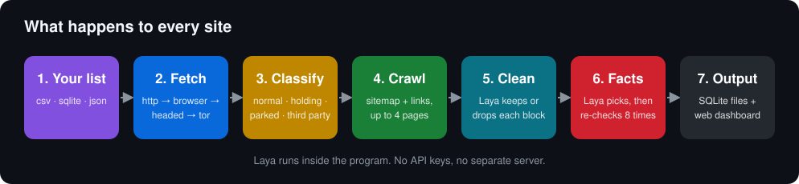
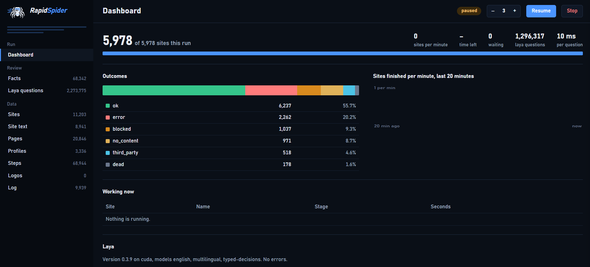
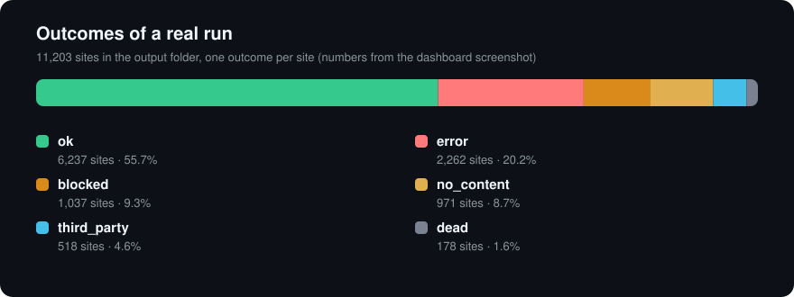
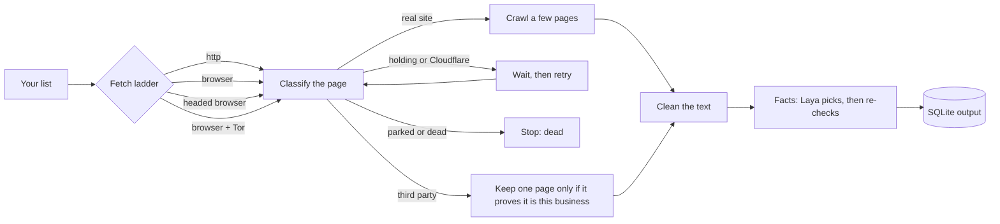

<p align="center"></p>

<h3 align="center">Give it a list of business websites.<br>Get back clean text and verified facts, ready for descriptions and bullet points.</h3>

<p align="center">
  
  
  
  
</p>

<p align="center">
  <a href="#start-in-5-minutes"></a>
  <a href="#proof-it-works"></a>
  <a href="#how-it-works"></a>
  <a href="#your-input"></a>
</p>
<p align="center">
  <a href="#configuration"></a>
  <a href="#facts"></a>
  <a href="#output"></a>
  <a href="#web-interface"></a>
  <a href="docs/README.md"></a>
</p>

<p align="center">
  <a href="#credits"></a>
  <a href="#credits"></a>
</p>

<p align="center"></p>

---

## What it is

RapidSpider reads a list of business websites, fetches each one, and keeps two things:

1. **The real text** of the site, with menus, cookie banners and boilerplate removed.
2. **Verified facts** a writer needs for a long description, a short description and bullet points: services, opening hours, years in business, accreditations, prices and more.

One `config.yml` drives everything. An AI model called **Laya** runs inside the program and makes the judgement calls (is this page parked? is this line boilerplate? does this sentence state an opening time?). No API keys. No separate server.

| You give it | You get back |
| --- | --- |
| A CSV, SQLite or JSON list with an `id` and a `url` (name, phone, address and email are optional) | One folder of SQLite files: cleaned site text, every page, every fact with its confidence and place on the page, one JSON profile per site, and a log of every decision |

---

## Start in 5 minutes

<a href="docs/getting-started.md"></a>

### 1. Copy the repo

```bash
git clone https://github.com/QudsLab/RapidSpider.git
cd RapidSpider
```

### 2. Install

```bash
pip install torch                  # CPU build. With an NVIDIA GPU install the CUDA build from pytorch.org instead
pip install -r requirements.txt
playwright install chromium        # one time
```

### 3. Add your sites

Create `input/sites.csv`. This folder is ignored by git, so your list stays yours.

```csv
id,website,name,town
1,https://example-practice.co.uk,Example Practice,Leeds
2,https://another-practice.co.uk,Another Practice,Bristol
```

Only `id` and `website` are required. Name and town help RapidSpider prove that a social or directory page is really about the business.

### 4. Run

```bash
python main.py config.yml
```

The first run downloads the Laya models once (a few GB). After that it works from the local cache.

### 5. Watch and read

Open **http://127.0.0.1:8800** to watch it live. Results are in `output/dental/`.

> **Stopping:** press `Ctrl+C`. Every browser RapidSpider started closes with it. Sites that were not finished stay pending and continue next time.

<details>
<summary><b>More ways to run it</b></summary>

```bash
python main.py config.yml --only 12,34           # only these input ids, good for testing one site
python main.py config.yml --requeue no_content   # run finished sites with that status again
```

</details>

<details>
<summary><b>Requirements</b></summary>

| | Needed | Notes |
| --- | --- | --- |
| Python | 3.10 or newer | Developed on 3.14 |
| Packages | `pip install -r requirements.txt` | Includes `laya`, which needs PyTorch |
| Browser | `playwright install chromium` | Used from the second step of the fetch ladder |
| Models | Downloaded on the first run | Internet needed once, then works from cache |
| GPU | Optional | With CUDA all three Laya models load. On CPU only English loads and runs are slower |
| RAM | About 10 GB free | `laya.max_ram_mb` unloads the least-used model above the limit |
| Disk | A few GB for models, plus the output | |
| Tor | Only for the `browser_tor` step | Run Tor on `127.0.0.1:9050` and set `network.tor_socks`. Remove the step from `fetch.ladder` if you do not use it |

</details>

---

## Proof it works

<p align="center"></p>

This is the built-in dashboard after a real run on a business directory: nothing running, queue finished.

<table align="center">
  <tr>
    <td align="center"><b>5,978</b><br><sub>sites in that run</sub></td>
    <td align="center"><b>11,203</b><br><sub>sites in the output</sub></td>
    <td align="center"><b>68,342</b><br><sub>facts stored</sub></td>
    <td align="center"><b>20,846</b><br><sub>pages fetched</sub></td>
    <td align="center"><b>3,336</b><br><sub>site profiles</sub></td>
  </tr>
  <tr>
    <td align="center"><b>1,296,317</b><br><sub>Laya questions in that run</sub></td>
    <td align="center"><b>2,273,775</b><br><sub>Laya questions logged</sub></td>
    <td align="center"><b>10 ms</b><br><sub>per question (GPU)</sub></td>
    <td align="center"><b>3 models</b><br><sub>english, multilingual, typed-decisions</sub></td>
    <td align="center"><b>0 errors</b><br><sub>reported by Laya</sub></td>
  </tr>
</table>

<p align="center"></p>

Every number above is read from the screenshot. Sites that fail (`error`, `blocked`) are expected on the open web: some refuse every request. They are stored with the reason, and `error` sites are retried on the next run.

---

## How it works

<a href="docs/pipeline.md"></a>



1. **Fetch.** The home page is requested with plain HTTP first. If it is not accepted, RapidSpider escalates: headless browser, visible browser, then browser through Tor.
2. **Classify.** Each page is recognised as normal, a "please wait" shield, a Cloudflare check, a dead or parked domain, a third-party page (social profile, directory, group site) or empty. `classes:` in the config says what to do for each.
3. **Crawl.** A few more pages come from the sitemap and links, ranked by Laya.
4. **Clean.** Boilerplate, cookie text and near-duplicates are removed.
5. **Facts.** Laya finds the sentences that state each fact, then re-asks itself several times before it accepts one.
6. **Save.** Everything goes to the output folder.

Every site ends with one status:

| Status | Meaning | Counted as |
| --- | --- | --- |
| `ok` | Real site, text collected | finished with data |
| `third_party` | A social or directory page that proved it is this business | finished with data |
| `dead` | Domain gone or parked, confirmed more than once | finished, nothing to take |
| `blocked` | Login wall, or blocked on every step | finished, nothing to take |
| `no_content` | Page reached, but no real business text | finished, nothing to take |
| `error`, `timeout`, `laya_down` | Something failed | retried on the next run |

---

## Your input

<a href="docs/configuration.md#input"></a>

CSV, SQLite or JSON. Map your own column names in `config.yml`:

```yaml
input:
  path: input/sites.csv
  columns:
    id: id
    url: website
    name: name
    address: [town]          # a list is joined with ", "
```

---

## Configuration

<a href="docs/configuration.md"></a>

Everything lives in `config.yml`. Anything you leave out falls back to a built-in default, so a small file is enough.

| Section | Controls |
| --- | --- |
| `input` | Where the site list is and which columns mean what |
| `output` | Output folder, per-day folders, database size limit |
| `run` | Threads, retries, time budget per site, resume |
| `crawl` | How many pages, sitemap use, text size limits |
| `fetch` | The ladder (`http`, `browser`, `browser_headed`, `browser_tor`) and timeouts |
| `network` | Tor address and how dead domains are confirmed |
| `laya` | CPU or GPU, models, memory limit, example sets |
| `classes` | What to do for each kind of page |
| `parse` | How aggressively boilerplate is dropped |
| `facts` | Which facts to collect and how strictly to check them |
| `ui` | The web interface address and port |
| `logos` | Optional logo collection |

---

## Facts

<a href="docs/facts.md"></a>

`info.yml` lists the **ingredients** a description needs. Each has a key, a label, a bullet-point shape and a plain-English description that Laya reads.

```yaml
- key: opening_hours
  label: Opening hours
  bullet: "Open <days and hours>"
  description: "opening days and times, evening or Saturday appointments"
  patterns:
    - {re: '(?i)\b(?:mon(?:day)?)\s*(?:-|to)\s*(?:fri(?:day)?)[^.\n]{0,60}', value: 0}
```

How a fact is found and trusted:

1. **Code first.** Emails, phones, the business name and anything with a `patterns` regex are found by code, with no AI.
2. **Laya reads the page** in groups of eight numbered sentences and answers: which sentence states this ingredient, or none?
3. **The sentence is the fact.** Its place (top, middle, bottom, sentence number) is stored with it.
4. **Laya double-checks.** Each picked sentence is re-asked several times, worded differently with the answer keys flipped. It is accepted only when the rounds agree.

There is no manual review step.

---

## Output

<a href="docs/output.md"></a>

One folder per config, `output/<name>/`. Every database file rolls over to the next number before it reaches `output.max_db_mb` (45), so no file reaches 50 MB.

| File | Contents |
| --- | --- |
| `track.db` | One row per site: status, reason, `done` code, attempts |
| `sites_*.db` | The cleaned text of each site and its contacts |
| `pages_*.db` | Each fetched page, with its full unfiltered text in `raw` |
| `facts_*.db` | Every fact: ingredient, sentence, confidence, votes, location, source page |
| `profiles_*.db` | One JSON profile per site. `ready = 1` when enough categories are covered |
| `laya_calls_*.db` | Every question Laya was asked and its answer |
| `incidents_*.db`, `run_log_*.db` | Every ladder step and the run log |
| `site_logs_*.db` | One readable log per finished site |
| `logos_*.db`, `logos/<id>/` | Logo candidates and saved image files |

```sql
-- how did the run go?
SELECT status, COUNT(*) FROM track GROUP BY status ORDER BY 2 DESC;
```

---

## Web interface

<a href="docs/web-ui.md"></a>

While a run is going, open **http://127.0.0.1:8800** (set under `ui:` in `config.yml`).

- **Dashboard:** progress, speed, outcomes, what is running now, pause, resume, thread count, stop.
- **Tables:** every output table has its own page. Click a column to sort, use the search box and drop-downs to filter, click a row for its detail.
- **Laya questions:** open any question to see the text it judged, its answer, the nearest solved example and the other checks on the same text.

---

## Teaching Laya

<a href="docs/laya.md"></a>

Laya is shown solved examples next to every question, so you steer it by adding examples:

| Where | Written by | Use |
| --- | --- | --- |
| `laya.examples` in `config.yml` | you | Examples for your own niche |
| `learned_examples.yml` | you, in the web interface or by hand | Fixes to wrong answers |
| `learned_auto.yml` | RapidSpider | Decisions every verification round agreed on. Safe to delete, it is rebuilt |

---

## Documentation

<a href="docs/README.md"></a>

| Guide | What is in it |
| --- | --- |
| [Getting started](docs/getting-started.md) | Install, first run, CPU vs GPU |
| [Configuration](docs/configuration.md) | Every setting, with defaults |
| [The pipeline](docs/pipeline.md) | Fetch ladder, page classes, crawling, third-party pages |
| [Facts](docs/facts.md) | `info.yml`, ingredients, verification |
| [Laya](docs/laya.md) | Examples, learning, how to correct it |
| [Output](docs/output.md) | Every table and column, with queries |
| [Web interface](docs/web-ui.md) | Dashboard, tables, controls |
| [Troubleshooting](docs/troubleshooting.md) | Common problems and fixes |

---

## Credits

<p align="center">
  
  &nbsp;
  
</p>

<p align="center"><a href="https://www.rightbiz.co.uk"></a></p>

- **Made with [Claude](https://claude.ai)** by Anthropic. Claude helped build the code, the documentation and the graphics in this repository.
- **Well tested at [RightBiz](https://www.rightbiz.co.uk).**

---

## Responsible use

RapidSpider reads `robots.txt` only to find sitemaps and does not enforce its rules. Check the terms of the sites you collect from and the data protection rules that apply to what you store.

## License

MIT, see [LICENSE](LICENSE).
